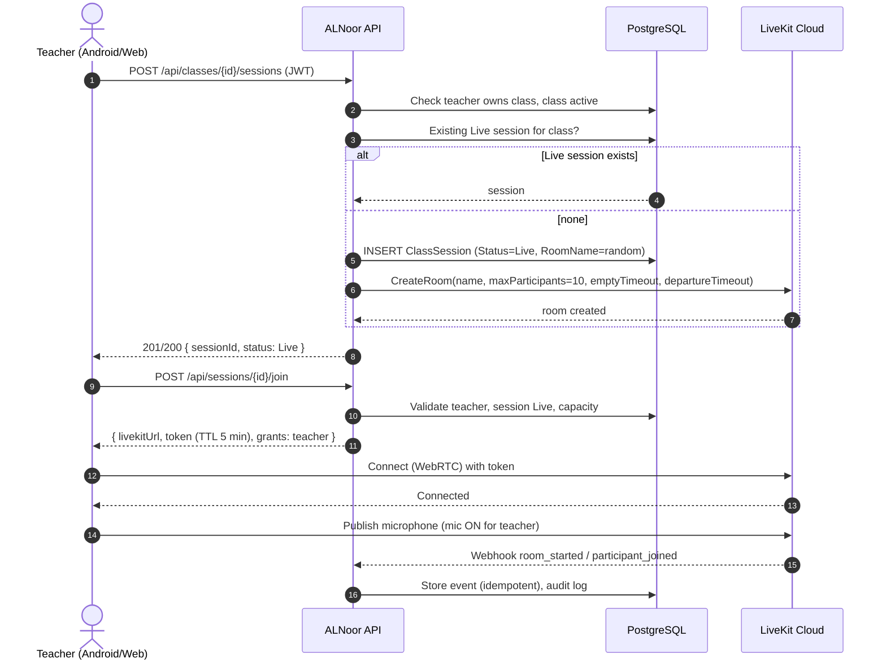
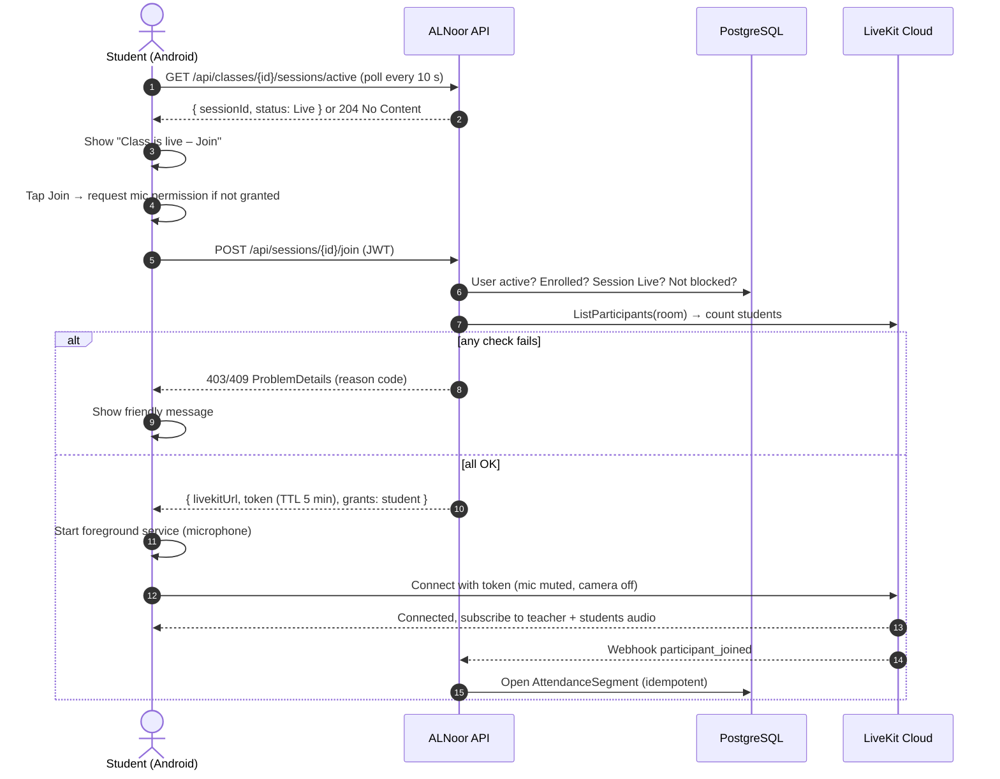
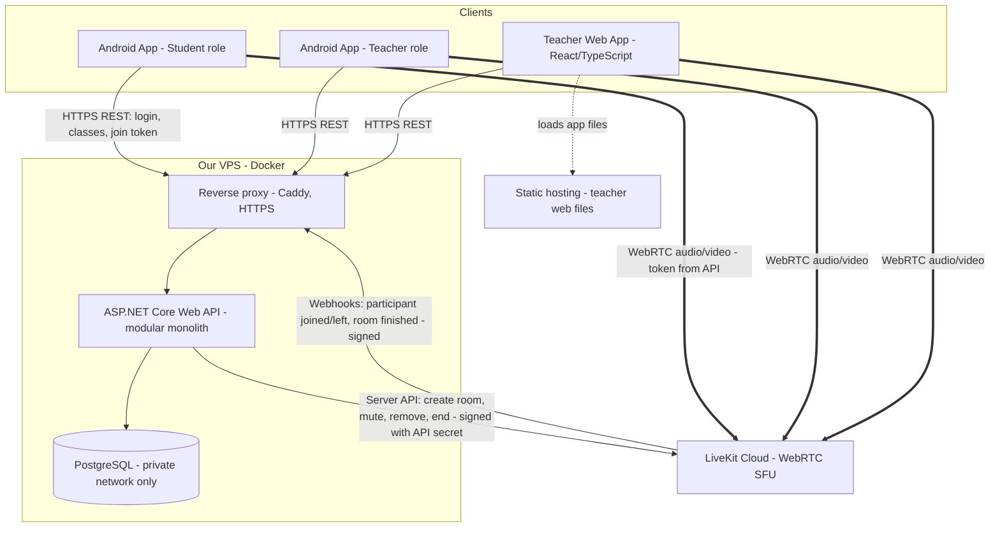
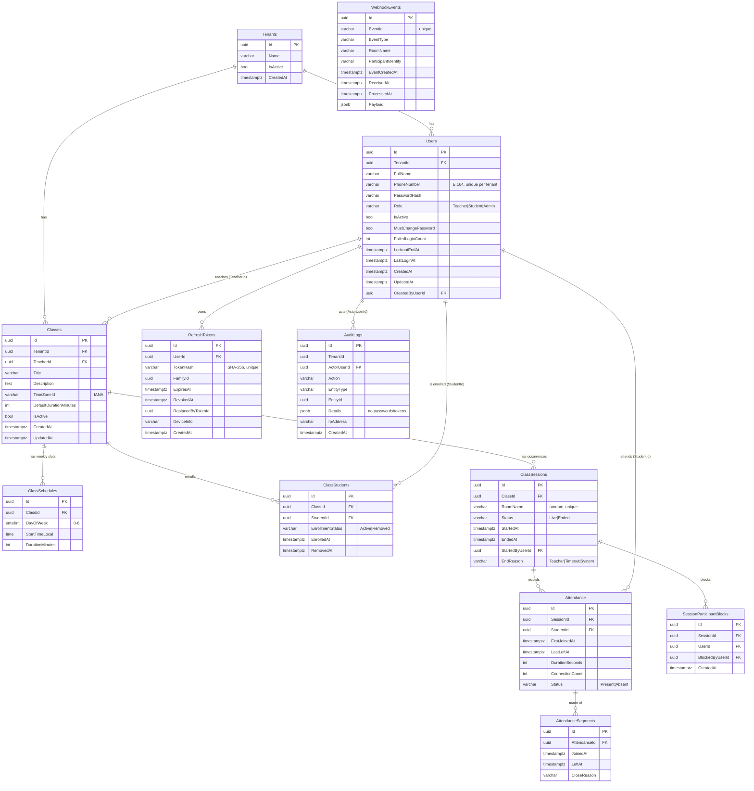
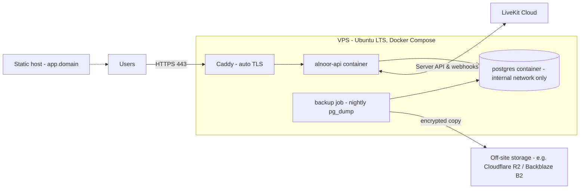

# ALNoor – Product Requirements Document (PRD)

| Field | Value |
|---|---|
| Product | ALNoor – Online Quran Classroom |
| Document version | 1.0 (Approved – all open questions Q1–Q15 answered) |
| Date | 2026-11-24 (v0.1: 2026-11-22) |
| Status | **Approved 2026-11-25. Development may start (Phase 1).** |
| Source brief | [PRD-master-prompt.md](PRD-master-prompt.md) |

How to read this document:

- **Requirement IDs** (e.g. `FR-AUTH-01`) are used so code, tests and commits can refer back to them.
- **[ASSUMPTION]** marks something the brief did not decide and this PRD assumed. Each one is repeated in §29 so it can be confirmed or changed.
- **[DECISION NEEDED]** marks an open question that blocks or shapes a later phase. These are also in §29.
- **"Verify at Phase 1"** marks versions and prices that change often. They were checked on 2026-11-22 but must be re-checked when the project is created.

---

## 0. Pre-PRD Analysis: Contradictions and Missing Decisions

The brief was analysed before writing the PRD. These are the issues found, with the resolution this PRD proposes. Items marked ✅ were decided by the owner on 2026-11-24 (see §29); no items remain open.

### 0.1 Contradictions in the brief

| # | Contradiction | Where | Proposed resolution |
|---|---|---|---|
| C1 | `POST /api/auth/register` is listed, but the brief also says "Do not assume public self-registration" and lists self-registration as future SaaS scope. | §4.1, §9, §18 | Keep the endpoint but make it **teacher/admin-only**: it creates a student account. No anonymous sign-up exists in V1. |
| C2 | "A recurring class should generate a separate session for every occurrence" and "View upcoming classes" imply scheduling. But "Class scheduling" is listed as a future SaaS feature. The `Classes` table also has a single `StartTime`/`EndTime`. | §4.2, §8, §18 | ✅ **Confirmed (Q5, 2026-11-24):** a class has a **simple weekly schedule** (days of week + start time + duration + time zone), used only to *show* upcoming times. A **session is created when the teacher taps "Start class"**. No calendar, reminders or automatic session generation in V1. "Class scheduling" in §18 is read as advanced scheduling (calendars, rescheduling, reminders). |
| C3 | "Use the LiveKit Cloud free Build plan initially" vs. the real class volume. The free plan includes **5,000 participant-minutes/month, and it is a hard cap** (joins fail after it is used up). One full 60-minute class of 10 people uses 600 minutes, so the free plan covers only about **8 full one-hour classes per month**. | §3, §6 | ✅ **Resolved by Q2 (2026-11-24):** the real schedule is **1–2 classes/week, 60 min, 5–9 students** (6–10 participants), which is about **2,600–5,200 participant-minutes/month**. That fits the free plan at 1/week and comes close to the limit at 2/week. **Start on the free Build plan**, keep development testing on a local LiveKit server, alert at 60/80/95%, and move to Ship (USD 50/month) only if usage reaches 80%. See §23. |
| C4 | "Teacher can mute a participant" is in scope. LiveKit lets the server **mute** a track but, by default, **not unmute** it (privacy protection). | §4.3 | Teacher can mute. Only the student can unmute themselves. This is shown clearly in the UI. |
| C5 | "Microphone enabled only after explicit user permission and classroom entry" vs. what state a student's mic is in on entry. | §5 | ✅ **Confirmed (Q4, 2026-11-24):** students **join muted** and unmute with one large button. Teacher joins with mic on. |
| C6 | "Video off by default" vs. "All participants may enable video" vs. "minimum infrastructure cost". 10 people on video uses roughly 6× the bandwidth of audio only and can use the free 50 GB within ~5 class-hours. | §4.3, §5, §6 | Video stays allowed but off by default. Audio-first fallback (§18) and the cost model (§23) treat video as the main cost driver. |
| C7 | The brief suggests a single `Attendance` row with `JoinedAt`/`LeftAt`, but also requires handling disconnections and avoiding duplicates. A student who drops and rejoins has several join/leave pairs. | §8, §12 | One `Attendance` row per student per session (unique), plus `AttendanceSegments` rows for each connection period. Duration = sum of segments. |

### 0.2 Missing decisions

| # | Missing decision | Why it matters | Proposed default |
|---|---|---|---|
| M1 | ✅ **Siblings sharing one phone number.** | Phone number cannot be the unique login key if two students share it. | **Confirmed (Q1):** every student has their own number. Phone number is **unique per account** and is the login. |
| M2 | ✅ **Password reset without OTP.** OTP is excluded from V1. | Users will forget passwords. | **Confirmed (Q9):** Teacher resets a student's password from the app (sets a temporary password, student must change it on next login). The teacher's own reset is done by the developer (admin script). |
| M3 | ✅ **Who is the Administrator?** "Only if needed". | Someone must create the first teacher account. | Settled with Q9 (developer handles teacher account tasks by script): no admin UI in V1. The first teacher account is created by a one-time seed command run by the developer. The `Admin` role exists in the database for later. |
| M4 | ✅ **App language(s).** | Urdu/Arabic need right-to-left (RTL) layout; this affects UI design from day one. | **Confirmed (Q6):** English UI in V1, with all text in resource files so Urdu/Hindi/Arabic can be added. Layouts use start/end (not left/right) so RTL works later. |
| M5 | ✅ **Time zones.** | "Upcoming class" times must show correctly for everyone. | **Confirmed (Q11):** everyone is in one time zone for now. Design kept anyway because it costs nothing and SaaS will need it: schedule is stored in the teacher's time zone (IANA id, e.g. `Asia/Kolkata`); all timestamps stored in UTC; each device shows local time. |
| M6 | ✅ **Typical class schedule.** | Decides whether the LiveKit free plan is enough (C3) and the monthly cost. | **Confirmed (Q2):** 1–2 classes/week in total, 60 min each, 5–9 students. See §23.2. |
| M7 | **Same user on two devices at once** (e.g. teacher on phone and web). | Duplicate participants and wrong attendance. | The LiveKit participant identity is the user id. When the same user joins again, LiveKit disconnects the older connection. The newest device wins. |
| M8 | **What happens if the teacher's connection drops?** | The class must not end because the teacher's phone lost signal for a moment. | The session stays live. If the teacher has been gone for more than 10 minutes and no one ended the class, the session ends automatically (configurable). |
| M9 | ✅ **After a teacher removes a student, can the student rejoin?** | Removing is pointless if the student can rejoin immediately. | **Confirmed (Q7):** Removed students cannot rejoin **that session**. They can join the next session. |
| M10 | ✅ **Minimum Android version / student devices.** | Old phones may not run WebRTC well; affects `minSdk`. | **Confirmed (Q10):** students mostly use recent phones (Android 10+). `minSdk 26` (Android 8.0) kept as a safety margin; test devices focus on Android 10+. |
| M11 | **Distribution.** "APK for the initial private pilot" — Play Store later? | Sideloaded APKs need "install unknown apps" and manual updates. | Signed APK shared privately for the pilot; Google Play (internal testing track) evaluated before wider use. |
| M12 | ✅ **Parental consent** for minors. | Required before public deployment and good practice even in a private pilot. | **Confirmed (Q12):** Written/recorded consent from a parent for each minor before the pilot (simple form); a privacy policy before any public release. |
| M13 | **Data retention** for attendance and audit logs. | Privacy and storage. | Keep attendance while the account exists; audit logs 12 months; webhook raw events 30 days. |
| M14 | **Does the teacher get attendance records?** | Only students are listed in the brief. | Only students are tracked in `Attendance`. The teacher's presence is recorded in session start/end and audit logs. |
| M15 | **Domain name.** | Needed for HTTPS and web app. | **Q13:** not needed now; decided at Phase 7. Then buy one low-cost domain (e.g. `alnoor-<something>.com`); use `api.` and `app.` subdomains. |

### 0.3 Things the brief left implicit that this PRD adds (minimum needed)

These are not new features. They are required for features the brief already asks for:

| Addition | Needed for |
|---|---|
| `PUT /api/students/{id}/status`, `POST /api/students/{id}/reset-password`, `GET /api/students` | "Account activation/deactivation", M2, adding students to a class |
| `GET /api/sessions/{id}`, `GET /api/classes/{id}/sessions/active` | Waiting/joining screen needs to know if the class has started |
| `PUT /api/auth/password` (change own password) | Temporary password after reset (M2) |
| `AttendanceSegments` table | C7 |
| `WebhookEvents` table | "Process webhooks idempotently" |
| `SessionParticipantBlocks` (or a flag on Attendance) | M9 |
| `Tenants` table with one row | Low-cost preparation for SaaS (see §15.4) |

---

## 1. Executive Summary

ALNoor is a small, dedicated live classroom app for online Quran classes. It replaces WhatsApp group video calls, which today cause audio drop-outs, unclear recitation, difficult joining and give the teacher little control.

V1 does one thing well: **a teacher and up to nine students join a private live class and hear each other clearly.** Video is optional and off by default. The teacher can run the whole class from an Android phone; a web app gives the teacher an extra option on a laptop.

The real-time audio/video is handled by **LiveKit Cloud** (a hosted WebRTC service). Our own backend (ASP.NET Core + PostgreSQL) handles accounts, classes, permissions and attendance, and gives each user a short-lived "ticket" (token) to enter a class only if they are allowed.

The first deployment is one teacher (the founder's wife) with her existing students. The design keeps cost close to zero during development, keeps the architecture simple (one backend, one database), and leaves room to become a multi-teacher SaaS later without a rewrite.

**Key finding for budget:** with the confirmed schedule (1–2 one-hour classes/week, 5–9 students), classes use about 2,600–5,200 of the LiveKit free plan's 5,000 participant-minutes/month (a hard limit). The pilot starts on the free plan, which keeps running cost at about **₹550–1,100/month** (server + domain). If usage reaches 80% of the free allowance (likely in months with 2 full classes a week), the owner is alerted and decides whether to move to LiveKit Ship, which raises total cost to about **₹5,000–6,500/month**. See §23.

## 2. Product Vision

> *A calm, reliable digital classroom where a Quran teacher and her students can hear every letter clearly, and joining a class is as easy as tapping one button.*

- **Short term (V1):** Replace WhatsApp calls for one teacher's classes.
- **Medium term:** Polish based on real classes; add the most-requested small features.
- **Long term:** Offer ALNoor to other Quran teachers and Islamic institutions as a SaaS.

## 3. Business Objectives

| ID | Objective | Measure (pilot) |
|---|---|---|
| BO-1 | Clear, uninterrupted audio for recitation under normal networks | ≥ 90% of pilot classes rated "clear" or better by the teacher; audio interruptions < 2 s total per participant-hour on normal networks (§25) |
| BO-2 | Easy joining | A student joins in ≤ 3 taps from opening the app; ≥ 95% of join attempts succeed on the first try |
| BO-3 | Teacher control | Teacher can see, mute and remove any participant and end the class from Android |
| BO-4 | Minimum cost | Development and early pilot within free tiers (except server/domain); running cost documented and monitored |
| BO-5 | SaaS-ready foundation | No major database/API rewrite needed to add a second teacher |

## 4. Target Users and Personas

| Persona | Description | Devices | Needs | Pain points today |
|---|---|---|---|---|
| **Ustadha (Teacher)** – primary | Experienced Quran teacher, the founder's wife. Teaches small groups (5–9). Not necessarily technical. | Android phone (primary); laptop with Chrome/Edge (optional) | Hear each student's recitation clearly; start a class quickly; control who speaks; know who attended | WhatsApp audio cuts; can't control participants; students struggle to join |
| **Student – child/teen** | Learns recitation; may be a minor; uses a parent's or their own phone | Android phone, often low/mid-range | One-tap join; simple mic button; works on home Wi-Fi or mobile data | Joining confusion; audio breaks |
| **Student – adult** | Adult learner | Android phone | Same as above | Same |
| **Parent/Guardian** (indirect) | Hands the phone to the child, may log in for them | Android | Safety; knows only the teacher and classmates can join | Group-call privacy |
| **Developer/Admin** (internal) | The founder; sets up accounts and runs the system | PC | Simple deployment, low cost, logs | — |

## 5. User Problems

| # | Problem | ALNoor response |
|---|---|---|
| P1 | Audio interruptions during recitation | WebRTC via LiveKit SFU, Opus codec, audio prioritised over video, adaptive quality |
| P2 | Unclear voice | Tuned audio settings tested with real recitation; noise suppression checked so it doesn't remove subtle sounds |
| P3 | Hard to join | Login once; "Join" button appears when the teacher starts; clear status screens |
| P4 | Network problems | Automatic reconnection with clear "Reconnecting…" state; audio-first fallback |
| P5 | Managing participants is inconvenient | Enrolled-students-only classes; teacher's participant list with mute/remove |
| P6 | Teacher has limited control | Start/end class, mute, remove, see joining/leaving and connection quality |

## 6. Product Scope

### 6.1 In scope (V1)

- Phone number + password login; JWT + refresh tokens; logout; roles (Teacher, Student; Admin reserved).
- Teacher creates student accounts, activates/deactivates them, resets their passwords.
- Class management: create/edit class, simple weekly schedule (display only, see C2), enroll/remove students.
- Sessions: teacher starts and ends a live session; students join the active session.
- Live classroom: audio (primary), optional video, mic/camera toggles, participant list, connection status, teacher mute/remove/end, late join, reconnection.
- Attendance from LiveKit webhooks + backend state; teacher and student history views.
- Android app (teacher + student in one app, role-based screens).
- Teacher web app (React).
- Deployment for a private pilot.

### 6.2 Out of scope (V1)

Chat, file sharing, screen sharing, recording (of any kind, including diagnostics), Quran text/content libraries, recitation management, OTP/SMS, public self-registration, push notifications, payments, multi-teacher/multi-organization features, admin dashboard, custom branding, calendar/reminder scheduling, iOS app, student web app.

### 6.3 One Android app or two?

**Decision (proposed): one Android app** that shows teacher or student screens based on the role returned by the server. Reasons: one codebase, one APK to distribute, less work. The role always comes from the server, never from the app.

## 7. Functional Requirements

Priority: **M** = must for V1, **S** = should (V1 if time allows).

### 7.1 Authentication & accounts

| ID | Requirement | Priority |
|---|---|---|
| FR-AUTH-01 | User logs in with phone number (E.164 format, e.g. `+919876543210`) and password. | M |
| FR-AUTH-02 | Passwords are hashed with a modern slow hash (PBKDF2 via ASP.NET Core Identity `PasswordHasher`, or Argon2id). Plain passwords are never stored or logged. | M |
| FR-AUTH-03 | On login, server returns a short-lived access token (JWT, 15 min) and a refresh token (30 days, rotating). | M |
| FR-AUTH-04 | Client silently refreshes the access token; a reused (stolen) refresh token revokes that token family. | M |
| FR-AUTH-05 | Logout revokes the current refresh token. | M |
| FR-AUTH-06 | Deactivated users cannot log in, refresh, or get a classroom token; deactivation also revokes their refresh tokens and removes them from any live room. | M |
| FR-AUTH-07 | Roles: Teacher, Student, Admin (reserved). The role is read from the database on the server for every protected action. | M |
| FR-AUTH-08 | Teacher creates student accounts (name, phone, temporary password). No public sign-up. | M |
| FR-AUTH-09 | Teacher resets a student's password to a temporary one; student must change it at next login. | M |
| FR-AUTH-10 | User can change their own password. | M |
| FR-AUTH-11 | First teacher account is created by a developer seed command. | M |
| FR-AUTH-12 | Login is rate-limited and temporarily locked after repeated failures. | M |

### 7.2 Class management

| ID | Requirement | Priority |
|---|---|---|
| FR-CLS-01 | Teacher creates a class: title, optional description, weekly schedule (days, start time, duration), time zone. | M |
| FR-CLS-02 | Teacher edits a class and can archive (deactivate) it. | M |
| FR-CLS-03 | Teacher views enrolled students of a class. | M |
| FR-CLS-04 | Teacher adds existing students to a class and removes them. Max 9 enrolled students per class (confirmed, Q15). | M |
| FR-CLS-05 | Teacher and students see upcoming class times computed from the schedule, in their local time. | M |
| FR-CLS-06 | Students see only classes they are enrolled in. | M |
| FR-CLS-07 | Teacher sees only their own classes and students. | M |

### 7.3 Sessions

| ID | Requirement | Priority |
|---|---|---|
| FR-SES-01 | Teacher starts a session for a class; server creates the session (status `Live`) and the LiveKit room. | M |
| FR-SES-02 | Only one live session per class at a time. Starting again returns the existing live session. | M |
| FR-SES-03 | Teacher ends the session for everyone; the LiveKit room is closed; all are disconnected and see the "Class ended" screen. | M |
| FR-SES-04 | Session ends automatically if the room has been empty, or the teacher absent, for longer than the configured timeout (default 10 min). | M |
| FR-SES-05 | Students' class screen shows "Class is live – Join" when a session is live, otherwise "Waiting for teacher". The screen refreshes automatically (polling every 10 s in V1; no push). | M |

### 7.4 Live classroom

| ID | Requirement | Priority |
|---|---|---|
| FR-LIVE-01 | Join requires: logged in, active account, enrolled (or the class teacher), session live, not removed from this session, room not full. | M |
| FR-LIVE-02 | Max 10 participants including teacher; max 9 students. The teacher always has a reserved slot. | M |
| FR-LIVE-03 | Mic and camera toggles with large, clear on/off state. Camera off by default. Students join muted (C5). | M |
| FR-LIVE-04 | Participant grid/list shows names, mic state, camera state, speaking indicator, and connection quality (good/poor/lost). | M |
| FR-LIVE-05 | Teacher can mute a participant's microphone. The student sees "The teacher muted you". | M |
| FR-LIVE-05a | Teacher can **mute all students** at once with one button (with confirmation). Each student sees "The teacher muted everyone" and can unmute themselves. *(Added by Q14, 2026-11-24.)* | M |
| FR-LIVE-06 | Teacher can remove a participant (with confirmation). Removed student cannot rejoin this session. | M |
| FR-LIVE-07 | Teacher can end the class for everyone (with confirmation). | M |
| FR-LIVE-08 | Everyone sees join/leave notices ("Aisha joined"). | M |
| FR-LIVE-09 | Late joining is allowed any time while the session is live. | M |
| FR-LIVE-10 | Connection states shown: Joining, Connected, Reconnecting, Disconnected, Failed (§20). | M |
| FR-LIVE-11 | Leaving the class returns to the class screen; the user can rejoin while it is live. | M |
| FR-LIVE-12 | Audio-first mode: user (or app automatically, on poor connection) turns off incoming video to keep audio (§18). | M |
| FR-LIVE-13 | Audio keeps working when the screen is locked or the app is in the background (Android foreground service, §20.4). | M |
| FR-LIVE-14 | Speaker/earpiece/Bluetooth/wired headset output selection. | S |
| FR-LIVE-15 | Screen sharing, chat, data messages and recording are disabled at the token level. | M |

### 7.5 Attendance

| ID | Requirement | Priority |
|---|---|---|
| FR-ATT-01 | System records each student's join and leave times per session from LiveKit webhooks. | M |
| FR-ATT-02 | Short disconnections are merged; duration is the total connected time. | M |
| FR-ATT-03 | Exactly one attendance record per student per session. | M |
| FR-ATT-04 | Teacher sees per-session attendance (present/absent, first join, last leave, duration, reconnect count) and per-student history. | M |
| FR-ATT-05 | Student sees own attendance history. | M |

## 8. Non-functional Requirements

| ID | Category | Requirement |
|---|---|---|
| NFR-01 | Audio | Audio has priority over video in bandwidth and CPU. Measured targets in §25. |
| NFR-02 | Join time | From tapping "Join" to hearing audio: ≤ 5 s on 4G/Wi-Fi (p90). |
| NFR-03 | Reliability | App survives Wi-Fi ↔ mobile data switch with automatic reconnection in ≤ 10 s (p90) when a network is available. |
| NFR-04 | Performance | Live classroom runs on a mid-range Android phone (e.g. 4 GB RAM, 2021+) with 10 participants, video on, without audio glitches from CPU overload; video tiles are reduced automatically if needed. |
| NFR-05 | Battery | Audio-only class of 60 min uses ≤ 15% battery on a mid-range phone [ASSUMPTION – validate in testing]. |
| NFR-06 | Data use | Audio-only ≈ 0.15–0.2 GB/hour per participant; video on ≈ up to 1 GB/hour (shown to users in help text). |
| NFR-07 | Availability | Backend target 99% during scheduled class hours for the pilot (single server). |
| NFR-08 | Security | OWASP ASVS level 1 basics; see §21. |
| NFR-09 | Privacy | No recordings; minimal personal data (name, phone). |
| NFR-10 | Usability | Touch targets ≥ 48 dp; text ≥ 14 sp body, ≥ 16 sp buttons; WCAG AA contrast (4.5:1). |
| NFR-11 | Localisation | All UI strings externalised; RTL-safe layouts (M4). |
| NFR-12 | Maintainability | Modular monolith; each module testable; no secrets in code. |
| NFR-13 | Browser support | Teacher web: latest Chrome and Edge on desktop/laptop. |
| NFR-14 | Android support | minSdk 26, targetSdk = latest stable (36 at time of writing; verify at Phase 1). |

## 9. User Stories

| ID | As a… | I want to… | So that… | Acceptance (summary) |
|---|---|---|---|---|
| US-01 | Teacher | log in with my phone number and password | I can manage my classes | Valid credentials → dashboard; wrong → clear error; locked after repeated failures |
| US-02 | Teacher | create student accounts | only my students can use the app | Student created with temporary password; must change at first login |
| US-03 | Teacher | deactivate a student | they lose access immediately | Cannot log in or join; removed from live room |
| US-04 | Teacher | reset a student's password | they can get back in without OTP | Temporary password works once, then forced change |
| US-05 | Teacher | create a class with a weekly time | students know when to come | Class visible to enrolled students with next time in local time |
| US-06 | Teacher | add/remove students in a class | the right people can join | Only enrolled students see and can join |
| US-07 | Teacher | start a class from my phone | I don't need a laptop | One tap → I'm in the room with mic on |
| US-08 | Teacher | see who joined and their connection | I know who can hear me | Participant list updates within 2 s |
| US-09 | Teacher | mute a student | I can stop background noise | Student's mic muted; they see a notice |
| US-10 | Teacher | remove a participant | I can keep the class safe | Participant disconnected and cannot rejoin this session |
| US-11 | Teacher | end the class for everyone | the class closes properly | All disconnected; attendance finalised |
| US-12 | Teacher | see attendance per session and per student | I can track regularity | Correct present/absent and durations |
| US-13 | Student | see my classes and the next class time | I know when to join | List of enrolled classes with next time |
| US-14 | Student | join with one tap when class is live | I don't miss the start | "Join" visible within 10 s of teacher start |
| US-15 | Student | turn my mic on/off easily | I recite when asked | Big button, clear state |
| US-16 | Student | turn my camera on/off | the teacher can see me if needed | Camera off by default |
| US-17 | Student | stay in the class if my network blips | I don't have to rejoin | "Reconnecting…" then back automatically |
| US-18 | Student | keep hearing the class with my screen locked | I can hold the phone normally | Audio continues; notification shown |
| US-19 | Student | see my attendance history | I and my parents know my record | List of sessions with status/duration |
| US-20 | Teacher (web) | run the class from my laptop | I can use a bigger screen when available | Same core classroom functions in Chrome/Edge |

## 10. Detailed User Workflows

### 10.1 Teacher starts a class



### 10.2 Student joins a class



### 10.3 Teacher moderation (mute / remove / end)

1. Teacher taps a participant → sheet with **Mute** and **Remove**.
2. Mute → `POST /api/sessions/{id}/participants/{userId}/mute` → backend finds the participant's microphone track via LiveKit `ListParticipants`, calls `MutePublishedTrack(muted=true)`. Student sees "The teacher muted your microphone. Tap to unmute when asked."
3. Remove → confirmation → `POST …/remove` → backend writes a block for this session, calls `RemoveParticipant`. Student sees "You were removed from this class."
4. End → confirmation → `POST /api/sessions/{id}/end` → backend sets session `Ended`, calls `DeleteRoom` (disconnects everyone), closes open attendance segments.

### 10.4 Student leaves and rejoins

Tap **Leave** → client disconnects → `POST /api/sessions/{id}/leave` (informational) → webhook `participant_left` closes the segment. Student can tap **Join** again while live; a new segment opens and the attendance record is the same.

### 10.5 Teacher creates a student and enrolls them

Dashboard → Students → **Add student** (name, phone, temporary password shown once to share privately) → Classes → class → **Add students** (pick from list) → saved.

## 11. UI/UX Screen Requirements

### 11.1 Design direction

| Element | Spec |
|---|---|
| Primary colour | Deep green, e.g. `#0F5132` (final palette in Phase 4) |
| Accent | Subtle gold, e.g. `#C9A227`, used sparingly (active states, headers) |
| Background | White / off-white `#FAFAF7`; dark theme optional later |
| Error / muted state | Red `#B3261E` for "mic off"/errors; green for "mic on" |
| Typography | System default (Roboto on Android; system-ui on web) for readability; one Arabic-friendly font added only if Arabic UI is chosen (M4) |
| Decoration | At most one light geometric motif on splash/login; none on the classroom screen |
| Icons | Material Symbols (mic, mic_off, videocam, videocam_off, call_end, group) with text labels under main controls |
| Touch targets | ≥ 48 dp; classroom control buttons ≥ 64 dp |
| Feedback | Every action gives visible feedback within 300 ms (spinner, toast, state change) |

### 11.2 Android screens

| # | Screen | Who | Key content | Notes |
|---|---|---|---|---|
| 1 | Splash | All | Logo, loading | Checks stored refresh token → dashboard or login |
| 2 | Login | All | Country code + phone, password, Login button, "Forgot password? Ask your teacher" text | Shows lockout/deactivation messages clearly |
| 2a | Change password | All | Forced after temporary password | — |
| 3 | Teacher dashboard | Teacher | Live session banner (if any), today's classes, quick "Start" buttons, links to Classes/Students/Attendance | — |
| 4 | Student dashboard | Student | Enrolled classes with next time; big "Join" when live | Auto-refresh every 10 s while visible |
| 5 | Class list | Teacher | Classes with schedule and student count; "New class" | — |
| 6 | Class details | Both | Schedule, enrolled students (teacher), Start (teacher)/Join (student), attendance link | — |
| 7 | Student management | Teacher | List, add, edit name, activate/deactivate, reset password | Confirmation dialogs |
| 8 | Upcoming class | Student | Next class time (local), "Waiting for teacher" | Merged into screen 4/6 if simpler |
| 9 | Waiting / joining | Both | Mic permission prompt, mic/camera pre-toggles, "Connecting…" | Explains why mic permission is needed |
| 10 | Live classroom | Both | Teacher tile large; student tiles small grid; bottom bar: Mic, Camera, Audio-only, Participants, Leave/End | Status pill top: Connected/Reconnecting; poor-connection banner |
| 11 | Participant list | Both (actions: teacher) | Names, mic/camera icons, connection quality; Mute/Remove for teacher; **Mute all** button at the top for teacher | Join/leave toasts |
| 12 | Class ended | Both | "Class ended" + duration; back to dashboard | Also shown on removal with a different message |
| 13 | Attendance/history | Both | Teacher: per session & per student; Student: own history | — |
| 14 | Profile/settings | Both | Name, phone, change password, audio output, logout, app version, privacy policy link | — |

**Live classroom layout (phone portrait):** top 40% teacher tile (avatar with name and speaking ring when camera off); below, a 3-column grid of up to 9 student tiles (initials + mic icon); fixed bottom control bar. For students, the teacher tile is always first; for the teacher, the currently speaking student is highlighted.

### 11.3 Teacher web screens

| # | Screen | Notes |
|---|---|---|
| 1 | Login | Same rules as Android |
| 2 | Dashboard | Same content as Android teacher dashboard |
| 3 | Class management | Create/edit, schedule, enrolled students |
| 4 | Student management | Same as Android |
| 5 | Waiting room | Device check: choose mic/camera/speaker, mic level meter, then "Start/Join" |
| 6 | Live classroom | Built with LiveKit React components, custom-styled; grid layout |
| 7 | Participant management | Side panel with mute/remove |
| 8 | Attendance/history | Tables |

## 12. System Architecture

### 12.1 High-level architecture

Two separate kinds of traffic:

- **Application API (HTTPS/JSON):** login, classes, permissions, attendance. Goes to our backend.
- **Real-time media (WebRTC):** audio/video. Goes **directly** between apps and LiveKit Cloud. Our backend never carries audio/video.



### 12.2 Backend modules (one deployable app)

| Module | Responsibility |
|---|---|
| `Auth` | Login, tokens, passwords, roles, lockout |
| `Users` | Student accounts, activation, password reset |
| `Classes` | Classes, schedule, enrollment |
| `Sessions` | Session lifecycle, join authorization, moderation |
| `LiveKit` | Token creation, server API client, webhook verification |
| `Attendance` | Webhook → attendance segments; reports |
| `Audit` | Audit log writing |
| `Shared` | DB context, errors, time (`TimeProvider`), tenant context |

Folder style: `src/ALNoor.Api` with one folder per module (`Features/Auth`, `Features/Classes`…); `tests/ALNoor.Api.Tests`. No separate microservices, no message broker.

### 12.3 Android app architecture

MVVM + unidirectional data flow: `Compose Screen → ViewModel (StateFlow) → Repository → Retrofit API / LiveKit Room`. Modules kept as packages in one Gradle module in V1 (`ui`, `data`, `domain`, `livekit`, `di`) to avoid build complexity. A `ClassroomManager` (singleton, scoped to the foreground service) owns the LiveKit `Room` so that rotating the screen or leaving the screen does not drop the call.

### 12.4 Teacher web app architecture

Vite + React + TypeScript; React Router; TanStack Query for API data; `@livekit/components-react` for the classroom. Access token kept in memory; refresh token in an `HttpOnly; Secure; SameSite=Strict` cookie set by the API.

## 13. Technology Stack

Versions below were checked on 2026-11-22 and must be re-verified when Phase 1 starts ("Verify at Phase 1"). Pin exact versions in the project once chosen.

| Layer | Choice | Version guidance | Notes |
|---|---|---|---|
| Backend runtime | .NET 10 (LTS) | .NET 10 LTS, supported until **14 Nov 2028**. Latest patch reported as 10.0.15 / SDK 10.0.404 (Nov 2026; unconfirmed – check `dotnet --list-sdks`) | .NET 11 (STS) was just released; stay on 10 LTS for longer support |
| Web framework | ASP.NET Core 10 Web API (controllers or minimal APIs) | matches runtime | Built-in rate limiting, ProblemDetails, OpenAPI |
| ORM | EF Core 10 + Npgsql EF Core provider 10.x | matches runtime | Migrations in source control |
| Database | PostgreSQL 18 (or 17) | latest stable supported by host | Runs in Docker on the VPS; not exposed publicly |
| Password hashing | ASP.NET Core Identity `PasswordHasher<T>` (PBKDF2) | built-in | Full Identity UI not needed |
| JWT | `Microsoft.AspNetCore.Authentication.JwtBearer` | 10.x | — |
| Phone parsing | `libphonenumber-csharp` | latest | Normalise to E.164 |
| LiveKit server | Official .NET server SDK if available at Phase 1; otherwise generate tokens with standard JWT library and call LiveKit's Twirp HTTP API (`/twirp/livekit.RoomService/...`) directly | verify | LiveKit has no long-standing official .NET server SDK; community packages exist. Evaluate before choosing (Phase 2) |
| Logging | Serilog → console + rolling file (or Seq free) | latest | No audio data in logs |
| Android language | Kotlin 2.x | latest stable | — |
| Android UI | Jetpack Compose (BOM, latest stable), Material 3 | latest stable | — |
| Android DI | Hilt | latest stable | — |
| Android HTTP | Retrofit + OkHttp + kotlinx.serialization | latest stable | — |
| Android storage | DataStore + Android Keystore encryption (e.g. Tink) for tokens | latest | `EncryptedSharedPreferences` (security-crypto) is deprecated |
| Android RTC | LiveKit Android SDK `io.livekit:livekit-android` 2.x (2.26.x seen May 2026) + `livekit-android-compose-components` | verify at Phase 1 | — |
| Android build | Android Studio (latest stable), AGP latest, `minSdk 26`, `targetSdk 36` | verify | — |
| Web | React 19, TypeScript 7.x (decided 2026-11-25; was 5.x), Vite (latest), `livekit-client` 2.x, `@livekit/components-react` 2.x | verify | — |
| Hosting | Low-cost VPS (Linux, 2 vCPU/4 GB), Docker Compose, Caddy (automatic HTTPS) | — | §22 |
| Static web hosting | Cloudflare Pages / Netlify / Vercel free tier | — | — |
| RTC | LiveKit Cloud – Build (free) for dev, Ship for regular classes | — | §14, §23 |
| CI (optional) | GitHub Actions free tier | — | Build + test on push |

## 14. LiveKit Integration Design

### 14.1 Concepts in simple language

- **Room** = one live class session. Name is random (e.g. `s_7f3c9a…`), never a person's name or phone.
- **Participant identity** = our user id (GUID). **Display name** = user's first name (shown to others in the class). [ASSUMPTION: first name only is sent to LiveKit to minimise personal data.]
- **Access token** = a signed ticket (JWT) our backend creates with the LiveKit API secret. It says: who, which room, what they may do, and for how long.
- **Webhooks** = LiveKit tells our backend when people join/leave and when rooms open/close.
- **Server API** = our backend tells LiveKit to create rooms, mute tracks, remove people and close rooms.

### 14.2 Token authorization flow

```mermaid
sequenceDiagram
    autonumber
    participant C as Client (Android/Web)
    participant API as ALNoor API
    participant DB as PostgreSQL
    participant LK as LiveKit Cloud

    C->>API: POST /api/sessions/{id}/join  (Authorization: Bearer access JWT)
    API->>API: Validate access JWT (signature, expiry)
    API->>DB: Load user by id (ignore any role sent by client)
    API->>API: IsActive? role?
    API->>DB: Session exists and Status = Live?
    API->>DB: Teacher of class OR enrollment Active?
    API->>DB: Blocked from this session?
    API->>LK: ListParticipants(room)
    API->>API: Students connected < 9 (teacher always allowed)
    API->>API: Build LiveKit JWT: iss=API key, sub=userId, name, video grant {roomJoin, room, canPublish, canPublishSources, canSubscribe, canPublishData=false}, exp = now + 5 min
    API->>API: Sign with LiveKit API secret (server only)
    API->>DB: Audit log "token issued"
    API-->>C: { url, token, role, expiresAt }
    C->>LK: Connect with token
    LK->>LK: Verify signature and grants
    LK-->>C: Joined; LiveKit refreshes the token over the connection while connected
```

### 14.3 Grants

| Grant | Teacher | Student |
|---|---|---|
| `roomJoin` / `room` | ✓ / this room only | ✓ / this room only |
| `canSubscribe` | ✓ | ✓ |
| `canPublish` | ✓ | ✓ |
| `canPublishSources` | microphone, camera | microphone, camera |
| `canPublishData` | ✗ (no chat in V1) | ✗ |
| `canUpdateOwnMetadata` | ✗ | ✗ |
| `roomAdmin`, `roomRecord`, `roomCreate` | ✗ (moderation goes through our backend) | ✗ |
| Token TTL | 5 min (only needed to *connect*) | 5 min |
| Participant attributes/metadata | `{"role":"teacher"}` set by server | `{"role":"student"}` set by server |

Short TTL works because LiveKit keeps connected clients authorised by refreshing the token itself while the connection is alive. For a full reconnect (new connection), the client asks our API for a new token (§20).

### 14.4 Room settings

| Setting | Value | Why |
|---|---|---|
| `max_participants` | 10 | LiveKit enforces the hard limit as a second safety net |
| `empty_timeout` | 600 s | Room closes 10 min after it becomes empty |
| `departure_timeout` | 60 s | Grace period after last participant leaves |
| Room created by | Backend on session start | So settings are always ours |

The backend reserves one slot for the teacher by allowing at most 9 students (FR-LIVE-02).

### 14.5 Moderation API calls (server side)

| Action | LiveKit RoomService call |
|---|---|
| List participants | `ListParticipants(room)` |
| Mute student | `MutePublishedTrack(room, identity, trackSid, muted=true)` |
| Mute all students | `ListParticipants`, then `MutePublishedTrack` for each student's microphone track |
| Remove | `RemoveParticipant(room, identity)` (+ block in our DB) |
| End class | `DeleteRoom(room)` |
| Deactivated user in room | `RemoveParticipant` |

### 14.6 Webhooks

- Endpoint: `POST /api/webhooks/livekit`, public, no user JWT.
- Verify: the `Authorization` header contains a JWT signed with our LiveKit API secret; its `sha256` claim must match the SHA-256 of the raw request body. Reject if invalid (401).
- Events used: `room_started`, `room_finished`, `participant_joined`, `participant_left`, and (if available in the SDK version) `participant_connection_aborted`. Others are stored and ignored.
- **Idempotency:** each event has a unique `id`. Insert into `WebhookEvents` with a unique index on `EventId`; if it already exists, return 200 and do nothing.
- **Ordering:** events can arrive late or out of order. Use the event's `createdAt` time, not arrival time. A `participant_left` with no open segment is stored and ignored.
- Respond within a few seconds (return 200 quickly; processing is small enough to do inline in V1).
- Exact payload fields and header format: verify against LiveKit docs in Phase 5.

### 14.7 LiveKit Cloud plan facts (checked 2026-11-22, livekit.com/pricing and LiveKit "Quotas and limits" docs)

| Item | Build (free) | Ship | Scale |
|---|---|---|---|
| Price | USD 0/month, no card required | from USD 50/month | from USD 500/month |
| WebRTC participant-minutes | 5,000 included | 150,000 included, then USD 0.0005/min | 1.5 M included, then USD 0.0004/min |
| Downstream data transfer | 50 GB | 250 GB, then USD 0.12/GB | 3 TB, then USD 0.10/GB |
| Concurrent connections (project-wide) | 100 | 1,000 | 5,000 |
| Recording/transcode | 60 min (not used by ALNoor) | 600 min | 8,000 min |
| Server API rate limit | 1,000 req/min | same | same |
| **When allowance is used up** | **Hard cap: new connections fail. No overage billing.** | Overage billed at plan rates | Overage billed |
| Reset | 1st day of each calendar month, no rollover | same | same |

Important notes:

- **Participant-minutes count per person**: 10 people × 60 min = 600 participant-minutes.
- Free allowances are **shared across all your free projects** — making a second free project does not add minutes.
- No per-room participant cap was listed; our own limit is 10.
- No limits on webhooks or a note on pausing inactive projects were found on those pages.

### 14.8 Usage monitoring

1. LiveKit Cloud dashboard: check weekly during the pilot.
2. Backend computes participant-minutes per month from attendance segments (+ teacher time) and shows a simple "LiveKit usage this month" figure on the teacher/admin settings screen and in logs.
3. Alerts (log + email to developer) at **60%, 80% and 95%** of the plan allowance.
4. On Build plan (confirmed by Q3): **the owner decides** each time. At the 80% alert the developer/owner is told the numbers and chooses: switch to Ship, or reduce use (shorter classes, video off) for the rest of the month. If nothing is done and 100% is reached, new joins fail until the 1st of the next month.

### 14.9 Self-hosted LiveKit – future migration assessment

| Factor | Notes |
|---|---|
| What changes | LiveKit server (open source) runs on our VPS instead of LiveKit Cloud. App code stays almost the same; only the server URL and keys change. |
| Server | 2–4 vCPU, 4–8 GB RAM is enough for a few 10-person rooms [ASSUMPTION – load-test]. |
| Bandwidth | Same media volume as Cloud (§23.3): ~2–10 GB per class-hour. Need a provider with large included transfer (several TB). |
| Ports / firewall | UDP 50000–60000 (or a smaller range), TCP 7881, plus TURN over TLS on 443 for strict networks. |
| TURN | Required for users behind strict firewalls/mobile carriers; LiveKit has a built-in TURN server that needs its own domain + certificate. |
| Domain & SSL | `rtc.` and `turn.` subdomains; automatic certificates (Caddy/Let's Encrypt). |
| Monitoring | Prometheus metrics, uptime checks, log review. |
| Maintenance | OS updates, LiveKit upgrades, incident handling during class time — the main hidden cost. |
| Indicative cost | VPS ₹1,000–2,500/month with ample bandwidth, vs. LiveKit Ship ≈ ₹4,400+/month. |
| Recommendation | **Do not self-host in V1.** Re-evaluate when (a) monthly LiveKit bills consistently exceed ~₹10,000, or (b) multiple teachers join, or (c) data-location requirements appear. Pilot self-hosting on a test server first. |

## 15. Database Design and ER Diagram

### 15.1 Conventions

- Primary keys: `uuid` (generated in the app, UUIDv7 for index-friendly ordering).
- All timestamps `timestamptz`, stored in **UTC**; names end with `At` (`CreatedAt`, `UpdatedAt`).
- Phone numbers: `varchar(20)`, E.164 string.
- Enums stored as `varchar` with check constraints (readable, safe to extend).
- Soft deletion for users/classes via `IsActive`; no hard deletes in V1 except token cleanup.
- Optimistic concurrency on editable rows (`xmin` concurrency token in PostgreSQL via EF Core).

### 15.2 ER diagram



### 15.3 Keys, indexes and constraints

| Table | Constraint / index | Purpose |
|---|---|---|
| Users | `UNIQUE (TenantId, PhoneNumber)` | One account per phone per tenant (M1) |
| Users | `CHECK (Role IN ('Teacher','Student','Admin'))` | Valid roles |
| Classes | `INDEX (TeacherId, IsActive)` | Teacher's class list |
| ClassSchedules | `INDEX (ClassId)`; `CHECK (DayOfWeek BETWEEN 0 AND 6)` | — |
| ClassStudents | `UNIQUE (ClassId, StudentId)`; `INDEX (StudentId, EnrollmentStatus)` | No duplicate enrolment; student's classes |
| ClassSessions | `UNIQUE (RoomName)`; **partial unique** `UNIQUE (ClassId) WHERE Status = 'Live'`; `INDEX (ClassId, StartedAt DESC)` | One live session per class |
| Attendance | `UNIQUE (SessionId, StudentId)`; `INDEX (StudentId, SessionId)` | No duplicate attendance |
| AttendanceSegments | `INDEX (AttendanceId)`; partial index `WHERE LeftAt IS NULL` | Find open segment fast |
| SessionParticipantBlocks | `UNIQUE (SessionId, UserId)` | — |
| RefreshTokens | `UNIQUE (TokenHash)`; `INDEX (UserId)`; `INDEX (FamilyId)` | Token lookup and family revoke |
| WebhookEvents | `UNIQUE (EventId)` | Idempotency |
| AuditLogs | `INDEX (TenantId, CreatedAt DESC)`; `INDEX (EntityType, EntityId)` | — |

All foreign keys `ON DELETE RESTRICT` (we don't hard-delete).

### 15.4 TenantId: include in V1 or later?

**Recommendation: include `TenantId` in V1 on `Users`, `Classes` and `AuditLogs`, with exactly one tenant row, and no tenant features or UI.**

Why, in simple terms: adding a column and filling it with one value now costs almost nothing. Adding it later means changing every table and query while real data exists, which is the "major rewrite" the brief wants to avoid. Child tables (`ClassStudents`, `ClassSessions`, `Attendance`…) get the tenant through their parent class, so they don't need the column. The backend reads the tenant from the logged-in user (never from the client) and EF Core applies a global query filter. Multi-tenant features themselves (§28) stay out of V1.

### 15.5 Secure token storage

- Refresh tokens: random 256-bit values; only the **SHA-256 hash** is stored. The raw token is shown to the client once.
- LiveKit tokens are never stored.
- Temporary passwords are hashed like normal passwords and `MustChangePassword = true`.

## 16. API Specification

### 16.1 Common rules

| Rule | Detail |
|---|---|
| Base URL | `https://api.<domain>/api` |
| Format | JSON, UTF-8, `camelCase`; timestamps ISO-8601 UTC (`2026-11-22T14:00:00Z`) |
| Auth | `Authorization: Bearer <accessToken>` unless marked Public. Web refresh uses the cookie. |
| Errors | RFC 9457 ProblemDetails: `{ "type", "title", "status", "detail", "code", "errors" }`. `code` is a stable machine-readable value (e.g. `SESSION_NOT_LIVE`). |
| Common errors | 400 `VALIDATION_FAILED`, 401 `UNAUTHENTICATED`, 403 `FORBIDDEN`, 404 `NOT_FOUND` (also used when the user may not know the resource exists), 409 conflicts, 429 `RATE_LIMITED`, 500 `INTERNAL_ERROR` |
| Authorization | Role and ownership always loaded from DB. Client-sent roles are ignored. |
| Versioning | No version in URL for V1; add `/api/v2` only on breaking changes |
| Pagination | `?page=1&pageSize=20` (max 100) on list endpoints that can grow (attendance) |

### 16.2 Authentication

#### `POST /api/auth/login` — Public, rate-limited
Request: `{ "phoneNumber": "+919876543210", "password": "…", "deviceInfo": "Pixel 6 / Android 14" }`
Response 200:
```json
{ "accessToken": "eyJ…", "accessTokenExpiresAt": "2026-11-22T14:15:00Z",
  "refreshToken": "base64url…", "refreshTokenExpiresAt": "2026-12-22T14:00:00Z",
  "user": { "id": "uuid", "fullName": "Aisha K", "role": "Student", "mustChangePassword": false } }
```
(Web: `refreshToken` is set as an HttpOnly cookie instead of returned in the body.)
Validation: phone parseable to E.164; password 1–128 chars.
Errors: 401 `INVALID_CREDENTIALS` (same message for unknown phone and wrong password), 403 `ACCOUNT_DEACTIVATED`, 423 `ACCOUNT_LOCKED` (with `lockoutEndsAt`), 429.

#### `POST /api/auth/refresh` — Public (needs refresh token)
Request: `{ "refreshToken": "…" }` (Android) or cookie (web). Response 200: same shape as login. Old token is revoked and replaced (rotation).
Errors: 401 `INVALID_REFRESH_TOKEN`; reuse of a revoked token → 401 `REFRESH_TOKEN_REUSED` and the whole family is revoked; 403 `ACCOUNT_DEACTIVATED`.

#### `POST /api/auth/logout` — Authenticated
Request: `{ "refreshToken": "…" }` (or cookie). Response 204. Revokes that token; idempotent.

#### `GET /api/auth/me` — Authenticated
Response 200: `{ "id", "fullName", "phoneNumber", "role", "isActive", "mustChangePassword" }`.

#### `PUT /api/auth/password` — Authenticated *(added, M2)*
Request: `{ "currentPassword": "…", "newPassword": "…" }`. Response 204. Revokes all other refresh tokens.
Validation: new password ≥ 8 chars, not equal to current, not in a small common-password list. Errors: 400, 401 `INVALID_CREDENTIALS`.

#### `POST /api/auth/register` — Teacher (or Admin) only *(see C1)*
Purpose: create a student account. Request:
```json
{ "fullName": "Aisha Khan", "phoneNumber": "+919876543210", "temporaryPassword": "…" }
```
Response 201: `{ "id", "fullName", "phoneNumber", "role": "Student", "isActive": true, "mustChangePassword": true }`.
Validation: name 2–100 chars; phone valid E.164 and unique in tenant; temporary password ≥ 8 chars. Role is always `Student` (cannot be chosen by the caller).
Errors: 403 if caller is a student; 409 `PHONE_ALREADY_REGISTERED`.

### 16.3 Students *(added for activation/deactivation & reset)*

| Method & path | Auth | Purpose | Request | Response | Errors |
|---|---|---|---|---|---|
| `GET /api/students` | Teacher | List students created by / enrolled with this teacher | `?search=&isActive=` | `[{ id, fullName, phoneNumber, isActive, classCount }]` | — |
| `PUT /api/students/{id}` | Teacher | Edit name/phone | `{ fullName, phoneNumber }` | 200 student | 404, 409 phone |
| `PUT /api/students/{id}/status` | Teacher | Activate/deactivate | `{ isActive: false }` | 200 student | 404. Deactivation revokes refresh tokens and removes from live rooms |
| `POST /api/students/{id}/reset-password` | Teacher | Set temporary password | `{ temporaryPassword }` | 204 | 404, 400 |

### 16.4 Classes

#### `POST /api/classes` — Teacher
```json
{ "title": "Tajweed – Group A", "description": "Beginners",
  "timeZoneId": "Asia/Kolkata", "defaultDurationMinutes": 45,
  "schedule": [ { "dayOfWeek": 1, "startTimeLocal": "17:00", "durationMinutes": 45 },
                { "dayOfWeek": 3, "startTimeLocal": "17:00", "durationMinutes": 45 } ] }
```
Response 201: class object (below). Validation: title 2–100; description ≤ 500; valid IANA zone; duration 10–180; schedule 0–14 entries, no overlapping entries in the same class.

Class object:
```json
{ "id": "uuid", "title": "…", "description": "…", "timeZoneId": "Asia/Kolkata",
  "defaultDurationMinutes": 45, "isActive": true,
  "schedule": [ … ], "nextOccurrences": ["2026-11-23T11:30:00Z", "…"],
  "studentCount": 7, "liveSessionId": null,
  "teacher": { "id": "uuid", "fullName": "…" } }
```

| Method & path | Auth | Purpose | Notes / errors |
|---|---|---|---|
| `GET /api/classes` | Teacher, Student | Teacher: own classes; Student: enrolled active classes | `?includeInactive=false`. Students never see `studentCount` details of others beyond the count |
| `GET /api/classes/{id}` | Class teacher or enrolled student | Class details; teacher also gets `students: [{id, fullName, enrollmentStatus}]` | 404 if not allowed |
| `PUT /api/classes/{id}` | Class teacher | Edit (same body as create + `isActive`) | 404, 400; 409 if deactivating while a session is live |
| `POST /api/classes/{id}/students` | Class teacher | Enroll students: `{ "studentIds": ["uuid", …] }` | 200 with enrolled list. 400 if student inactive/not in tenant; 409 `CLASS_FULL` if enrolled would exceed 9; already enrolled → ignored (idempotent) |
| `DELETE /api/classes/{id}/students/{studentId}` | Class teacher | Remove enrollment (sets `Removed`) | 204; if the student is in the live room they are removed from it |

### 16.5 Sessions

#### `POST /api/classes/{id}/sessions` — Class teacher
Purpose: start a session. Request: `{}`. Response 201 (new) or 200 (already live):
`{ "id": "uuid", "classId": "uuid", "status": "Live", "startedAt": "…" }`
Errors: 404; 409 `CLASS_INACTIVE`; 502 `RTC_UNAVAILABLE` if LiveKit room creation fails (session not created).

#### `GET /api/classes/{id}/sessions/active` — Class teacher or enrolled student *(added)*
200 session object, or 204 if none live.

#### `GET /api/sessions/{id}` — Class teacher or enrolled student *(added)*
200 `{ id, classId, classTitle, status, startedAt, endedAt, endReason }`.

#### `POST /api/sessions/{id}/join` — Class teacher or enrolled student
Purpose: authorize and issue LiveKit token. Request: `{}`.
Checks in order: user active → class teacher or `Active` enrollment → session `Live` → not blocked → capacity (students < 9; teacher always allowed; a user already in the room is allowed because they replace their old connection).
Response 200:
```json
{ "livekitUrl": "wss://<project>.livekit.cloud", "token": "eyJ…",
  "expiresAt": "2026-11-22T14:05:00Z", "role": "Student",
  "roomName": "s_7f3c…", "identity": "uuid-of-user" }
```
Errors: 403 `NOT_ENROLLED`, 403 `ACCOUNT_DEACTIVATED`, 403 `REMOVED_FROM_SESSION`, 409 `SESSION_NOT_LIVE`, 409 `ROOM_FULL`, 404, 502 `RTC_UNAVAILABLE`.

#### `POST /api/sessions/{id}/leave` — participant
Informational (UI/analytics); attendance relies on webhooks. Response 204. Idempotent.

#### `POST /api/sessions/{id}/end` — Class teacher
Ends session, deletes LiveKit room, closes open attendance segments, marks absentees. Response 200 session (`status: "Ended"`). Idempotent (ending an ended session returns 200).

#### `GET /api/sessions/{id}/participants` — Class teacher (students get basic list from LiveKit in-room)
Response 200: `[{ "userId", "fullName", "role", "joinedAt", "isMicPublished", "isMicMuted", "isCameraOn" }]` from LiveKit `ListParticipants`, mapped to our users.

#### `POST /api/sessions/{id}/participants/{userId}/mute` — Class teacher
Request `{}`. Mutes the participant's microphone track. 204. Errors: 404 `PARTICIPANT_NOT_IN_ROOM`, 409 `NO_MICROPHONE_TRACK`, 400 if target is the teacher.

#### `POST /api/sessions/{id}/participants/mute-all` — Class teacher *(added, Q14)*
Request `{}`. Mutes every student's published microphone track (teacher's own mic untouched). Response 200: `{ "mutedCount": 6 }`. Idempotent; students already muted are skipped. Errors: 404, 409 `SESSION_NOT_LIVE`.

#### `POST /api/sessions/{id}/participants/{userId}/remove` — Class teacher
Request `{ "reason": "optional, ≤200 chars" }`. Blocks for this session, removes from room. 204. Errors: 404, 400 if target is the teacher.

### 16.6 Attendance

| Method & path | Auth | Response | Notes |
|---|---|---|---|
| `GET /api/sessions/{id}/attendance` | Class teacher | `{ session, records: [{ studentId, fullName, status, firstJoinedAt, lastLeftAt, durationSeconds, connectionCount }] }` | Includes absent enrolled students |
| `GET /api/classes/{id}/attendance` | Class teacher | Paged list of sessions with present/absent counts; `?from=&to=` | — |
| `GET /api/students/{id}/attendance` | That student, or a teacher of a class the student is in | Paged list `[{ sessionId, classTitle, startedAt, status, durationSeconds }]` | Others → 404 |

### 16.7 Webhook

#### `POST /api/webhooks/livekit` — Public, signature-verified
Content type `application/webhook+json`. Read raw body; verify `Authorization` JWT and body hash (§14.6). Response 200 on success or duplicate; 401 on invalid signature; 400 on unreadable body. Never returns internal details.

## 17. Authentication and Authorization

### 17.1 Token design

| Token | Format | Lifetime | Stored where |
|---|---|---|---|
| Access token | JWT, HS256 (secret ≥ 256 bits) or RS256; claims `sub` (user id), `tid` (tenant), `role`, `jti`, `exp` | 15 min | Android: memory; Web: memory |
| Refresh token | Random 32 bytes, base64url | 30 days, sliding via rotation | Android: DataStore encrypted with Keystore key; Web: HttpOnly Secure SameSite=Strict cookie on `api.` domain; Server: SHA-256 hash |
| LiveKit token | JWT signed with LiveKit secret | 5 min | Not stored |

The `role` claim in the access token is only a hint for the UI. Every protected API re-checks the user's role, `IsActive` and ownership from the database (a cached lookup of ≤ 30 s is acceptable).

### 17.2 Authorization matrix

| Action | Teacher (own) | Student (enrolled) | Admin (V1: none) |
|---|---|---|---|
| Create/edit student accounts | ✓ | ✗ | — |
| Create/edit class, enroll | ✓ | ✗ | — |
| View class | ✓ | ✓ (enrolled, active) | — |
| Start/end session | ✓ | ✗ | — |
| Join session | ✓ | ✓ | — |
| Mute/remove participant | ✓ | ✗ | — |
| View session/class attendance | ✓ | ✗ | — |
| View own attendance | — | ✓ | — |

### 17.3 Password & lockout policy

- Minimum 8 characters, max 128; no forced complexity rules (better for non-technical users); block the most common passwords.
- 5 failed attempts → 15-minute lockout; counter resets on success.
- Login rate limit: 10 requests/min per IP and 5/min per phone number.

## 18. Audio/Video Quality Strategy

### 18.1 Principles

1. **Audio first.** Audio is never sacrificed to keep video.
2. **Natural recitation.** Processing must not remove subtle sounds (e.g. ghunnah, qalqalah, soft letters, elongations).
3. **Measure, don't guess.** All values are starting points, tested with real recitation.

### 18.2 Starting configuration

| Setting | Starting value | Notes / test plan |
|---|---|---|
| Codec | Opus (WebRTC default) | — |
| Audio bitrate (publish) | 32 kbps mono; test 24 / 32 / 48 kbps | Brief suggests 24–32; 48 kbps tested because recitation has more detail than speech. Pick lowest that the teacher can't distinguish from higher. |
| Opus DTX (silence suppression) | On (default) — test Off | DTX saves bandwidth during silence; verify it doesn't clip soft word starts/ends |
| Opus RED (redundancy) | On (LiveKit default) | Helps with packet loss |
| Echo cancellation | On | Essential on phone speaker |
| Noise suppression | Test **On vs. Off** with recitation; default decided by test | Can remove soft sounds and long elongations |
| Auto gain control | Test On vs. Off; prefer Off for teacher if levels are steady | AGC can "pump" volume during long notes |
| Video codec | VP8 with simulcast (LiveKit default) | Broadest Android support |
| Video capture | 640×360 @ 15 fps | — |
| Simulcast layers | 360p / 180p | Small tiles use 180p |
| Adaptive stream | On | Only receive the resolution each tile needs; pause video for off-screen tiles |
| Dynacast | On | Stop sending layers no one watches |
| Camera default | Off | — |

### 18.3 Audio-first fallback

| Trigger | Action |
|---|---|
| User taps **Audio only** | Stop receiving all video; own camera off |
| Local connection quality = Poor for > 10 s | Show banner "Weak connection – switched to audio only to keep sound clear" and stop receiving video (user can turn back on) |
| Connection quality = Poor while own camera on | Suggest turning camera off; turn off automatically after 20 s of Poor [ASSUMPTION] |
| Teacher on Poor network | Same rules; teacher's audio is the most important stream |

### 18.4 Metrics collected (no audio content)

Every 10 s per participant (from WebRTC stats via the SDK), summarised client-side and sent to the API at the end of the session (`POST /api/sessions/{id}/quality-report` — **S priority**, can be deferred): packet loss %, jitter, round-trip time, audio concealment/interruption duration, reconnect count, received video resolution, connection quality changes. In Phase 2 the same values are read from the LiveKit Cloud dashboard and logs.

**Never recorded:** audio or video content, including for diagnostics.

### 18.5 Recitation test protocol (Phase 2 & 6)

1. Teacher recites a fixed passage (e.g. chosen by the teacher) containing ghunnah, madd, qalqalah, and soft letters.
2. Students on 3+ device types listen and rate clarity 1–5; teacher listens to two students reciting.
3. Repeat for each setting combination (bitrate × noise suppression × AGC × DTX) on Wi-Fi and 4G.
4. Repeat with a network limiter (e.g. 3% and 10% packet loss, 300 ms latency) using Android developer options / a router / a laptop hotspot shaper.
5. Choose the defaults with the best clarity score; record decisions in `docs/audio-decisions.md`.

## 19. Attendance Management

### 19.1 Rules

| Rule | Value |
|---|---|
| Source of truth | LiveKit webhooks (`participant_joined`/`participant_left`) + our session state |
| Who is tracked | Enrolled students (teacher not tracked, M14) |
| Record | One `Attendance` per (session, student), created on first join; absentees added when the session ends |
| Segment | Each join→leave pair is an `AttendanceSegment` |
| Reconnection grace | 60 s: if a student rejoins within 60 s of leaving, the gap is ignored (treated as connected) |
| Duration | Sum of segments (+ gaps < 60 s), capped to session start/end |
| Present | Total duration ≥ 1 min [ASSUMPTION – teacher may want a % of class instead] |
| Session end | Open segments closed at `EndedAt` |

### 19.2 Temporary reconnection vs. final departure

- **Quick network blip (seconds):** the LiveKit SDK "resumes" the existing connection. LiveKit does **not** send `participant_left`, so nothing changes in attendance.
- **Longer drop / full reconnect:** LiveKit sends `participant_left`, then `participant_joined` when the student is back. We close the segment and open a new one; if the gap ≤ 60 s the gap counts as present and `ConnectionCount` increases.
- **Final departure:** a `participant_left` with no rejoin before the session ends (or > 60 s gap). The segment stays closed at the leave time.
- **Duplicate/out-of-order events:** ignored by `EventId` uniqueness and by using event timestamps; a `participant_joined` while a segment is open (duplicate device) does not open a second segment.
- **Missed webhooks:** at session end, the backend calls `ListParticipants` (before deleting the room) to close/open segments correctly; any open segment is closed at `EndedAt`.

## 20. Network Recovery Strategy

### 20.1 States

| App state | Meaning | UI |
|---|---|---|
| CONNECTING | Getting token / connecting first time | "Joining class…" spinner |
| CONNECTED | Media flowing | Green "Connected"; connection quality icon |
| RECONNECTING | SDK is recovering automatically | Yellow banner "Reconnecting… you'll be back automatically"; controls disabled |
| DISCONNECTED | Left, removed, class ended, or recovery stopped | Message with reason; "Rejoin" if session still live |
| FAILED | Could not connect after retries | "Couldn't connect. Check your internet." + Retry |

### 20.2 Reconnection workflow

```mermaid
stateDiagram-v2
    [*] --> CONNECTING: Tap Join / token received
    CONNECTING --> CONNECTED: Room connected
    CONNECTING --> FAILED: Connect error (after 3 tries, backoff 1s/3s/7s)
    CONNECTED --> RECONNECTING: SDK Reconnecting event (network lost/changed)
    RECONNECTING --> CONNECTED: SDK Reconnected (resume or ICE restart)
    RECONNECTING --> APP_REJOIN: SDK Disconnected (reason not intentional)
    APP_REJOIN --> CONNECTING: GET session status; if Live, new token via /join
    APP_REJOIN --> DISCONNECTED: Session Ended / removed / not authorised
    CONNECTED --> DISCONNECTED: Leave / Removed / Room deleted (class ended)
    FAILED --> CONNECTING: User taps Retry
    APP_REJOIN --> FAILED: 5 app-level attempts or 2 min without success
    DISCONNECTED --> [*]
    FAILED --> [*]
```



### 20.3 Rules

1. Let the LiveKit SDK do its own recovery first. While the SDK says RECONNECTING, the app **does not** start a second connection.
2. Only if the SDK gives up (Disconnected with a non-intentional reason) does the app rejoin: check session status → get a new token → connect. Backoff: 2, 4, 8, 16, 30 s; stop after 5 attempts or 2 minutes → FAILED.
3. Before rejoining, refresh the access token if needed.
4. After reconnect: restore the user's mic state **only if it was on and the teacher had not muted them**; camera stays **off** after a full rejoin (safe default).
5. After reconnect: rebuild the participant list from the room (don't trust old local state).
6. Disconnect reasons from the SDK (`ROOM_DELETED`, `PARTICIPANT_REMOVED`, `DUPLICATE_IDENTITY`, etc.) map to clear messages and **no** automatic rejoin.
7. Not every failure is recoverable (e.g. no internet at all, captive Wi-Fi portals, very strict firewalls). The app says so clearly.

### 20.4 Android background, foreground service and interruptions

| Topic | Requirement |
|---|---|
| Foreground service | When the user joins, start a foreground service with `foregroundServiceType="microphone"` (add `camera` only while camera is on) and a persistent notification ("ALNoor class in progress – tap to return", with Mute and Leave actions). |
| Android 11+ (API 30+) | Apps can only use mic/camera in the background if the foreground service was **started while the app was visible**. So the service is started at the moment of joining, from the visible screen. |
| Android 14+ (API 34+) | The service type must be declared in the manifest, and the matching permissions `FOREGROUND_SERVICE`, `FOREGROUND_SERVICE_MICROPHONE` (and `FOREGROUND_SERVICE_CAMERA`) are required; `RECORD_AUDIO` must be granted before starting. Starting a mic/camera service from the background is not allowed. |
| Android 13+ (API 33+) | Ask for `POST_NOTIFICATIONS` so the in-call notification is visible (the service still runs without it). |
| Newer Android versions | Re-check foreground-service rules for the `targetSdk` chosen at Phase 1 (Google tightens these each release). |
| Screen lock | Audio continues; video publishing paused while screen is off [ASSUMPTION – saves battery and data]. |
| Incoming phone call | Android gives the mic to the phone call. App shows "Paused for phone call", mutes own mic, and restores after the call ends (mic stays muted; user unmutes). |
| Audio routing | Use the SDK's audio device handling for speaker/earpiece/Bluetooth/wired; switch automatically when headphones are plugged/unplugged. |
| Battery optimisation | Do not ask users to disable battery optimisation in V1; test on Xiaomi/Samsung/Oppo/Vivo which may kill background apps; document workarounds in help text if needed. |
| Doze | Not an issue during an active foreground service. |

## 21. Security and Privacy

### 21.1 Security controls

| Area | Control |
|---|---|
| Transport | HTTPS only (TLS 1.2+), HSTS on API and web; Android `networkSecurityConfig` blocks cleartext |
| Passwords | PBKDF2 (Identity hasher) or Argon2id; never logged |
| Tokens | Short access tokens; rotating hashed refresh tokens with reuse detection; LiveKit tokens 5 min |
| Server-side checks | Role, ownership, enrollment, session state, capacity re-checked on every request |
| Webhooks | Signature + body-hash verification; idempotent processing |
| Rate limiting | Auth endpoints (§17.3); join endpoint 20/min per user |
| Input validation | FluentValidation or DataAnnotations on every request; max lengths; E.164 phone validation |
| Database | PostgreSQL only on the private Docker network; app user with least privileges (no superuser); strong password |
| Secrets | Environment variables / Docker secrets on the server; `.env` files in `.gitignore`; `dotnet user-secrets` in development; no secrets in Android/web code |
| Room names | Random; no names/phones |
| Device permissions | Ask for mic at first join with an explanation; camera only when the user taps camera; handle "denied" with a clear way to open settings |
| Revocation | Deactivation revokes refresh tokens, blocks join, removes from live room |
| Audit | Log logins, failed logins, account changes, enrollment changes, session start/end, mute/remove |
| Dependencies | Dependabot/Renovate or monthly manual review; `dotnet list package --vulnerable`, `npm audit` |
| Headers (web/API) | CSP, X-Content-Type-Options, Referrer-Policy; CORS only for the web app origin |
| Android | R8/ProGuard minification for release; `allowBackup=false`; no tokens in logs |

### 21.2 Privacy

- **Data collected:** student full name, phone number, password hash, enrollment, attendance times, technical logs (IP addresses in audit logs). Nothing else.
- **Data shared with LiveKit:** user id, first name, room name, live media (not stored — no recording). LiveKit's data processing/location terms should be reviewed before public launch.
- **No recording** of audio/video in V1, including diagnostics.
- **Minors:** obtain parent/guardian consent before the pilot (M12); parents should know who can see/hear their child (teacher + classmates only).
- **Privacy policy** and terms required before any public release (and before Play Store listing). India's **Digital Personal Data Protection Act 2023** (and its Rules) requires verifiable parental consent for children's data — get legal advice before going public/SaaS.
- **Retention:** §0.2 M13. Deactivated accounts can be fully deleted on request (manual script in V1).

## 22. Deployment Architecture

### 22.1 Environments

| Environment | Purpose | Backend | Database | LiveKit | Web |
|---|---|---|---|---|---|
| Development | Developer PC | `dotnet run` | PostgreSQL in Docker Desktop | LiveKit Cloud "alnoor-dev" project (Build) or local `livekit-server --dev` | `npm run dev` |
| Testing | Pre-release checks with test accounts | Same VPS, separate container + DB (`alnoor_test`) on a `test-api.` subdomain [ASSUMPTION – saves cost] | Separate database | Separate LiveKit project (shares the free allowance!) | `test-app.` subdomain / preview deploy |
| Production | Real classes | VPS container | PostgreSQL container with volume | "alnoor-prod" project (Build → Ship) | `app.` subdomain |

Note: free allowances are shared across free LiveKit projects, so heavy testing reduces minutes left for classes. Prefer the local `livekit-server --dev` for most development work.

### 22.2 Production layout



### 22.3 Checklist

| Item | Plan |
|---|---|
| Domain & HTTPS | One domain; `api.`, `app.` (+ `test-api.`, `test-app.`) subdomains; Caddy gets Let's Encrypt certificates automatically; static host provides HTTPS for web |
| Firewall | Allow only 22 (SSH, key-only, ideally restricted IPs), 80, 443. PostgreSQL port **not** published |
| Environment variables | `ConnectionStrings__Default`, `Jwt__SigningKey`, `Jwt__Issuer`, `Jwt__Audience`, `LiveKit__Url`, `LiveKit__ApiKey`, `LiveKit__ApiSecret`, `Cors__AllowedOrigins`, `ASPNETCORE_ENVIRONMENT` |
| Secret management | `.env` file on server readable only by deploy user (chmod 600), not in Git; secrets rotated if leaked; GitHub Actions secrets if CI deploys |
| Migrations | EF Core migration bundle run as a step before starting the new container |
| Backup | Nightly `pg_dump` (compressed, encrypted) kept 7 daily + 4 weekly; copied off-site; **restore tested monthly** |
| Logging | Serilog JSON to stdout → Docker logs with rotation; error logs also to file; no personal data beyond user id |
| Monitoring | Free uptime monitor (e.g. UptimeRobot / Better Stack free) on `/health`; LiveKit usage alerts (§14.8); disk space alert |
| Rollback | Images tagged by Git commit; keep last 3; rollback = run previous tag. DB migrations written to be backward-compatible for one version; DB backup taken before each deploy |
| Android APK | Release build signed with a private keystore (backed up securely, never in Git); version code increments each release; shared via private link; in-app "update available" check against `GET /api/app/version` [S priority] |
| Web deploy | Build with `npm run build`; deploy `dist/` to static host; API URL set via build-time env |

## 23. Infrastructure Cost Estimate

### 23.1 Assumptions

- Exchange rate **USD 1 ≈ ₹88** (Nov 2026 assumption – verify). Card payments to foreign services may add **~3.5% forex markup** and **18% GST** depending on your bank and GST status.
- Class: 10 participants (teacher + 9) unless stated; LiveKit counts participant-minutes per person.
- Prices from livekit.com/pricing on 2026-11-22.

### 23.2 Participant-minutes per month

| Scenario | Calculation | Participant-min/month | Fits Build (5,000)? |
|---|---|---|---|
| A. Development & testing only | ~3 devices × 60 min × 15 days | ~2,700 | Yes |
| B. 1 class/week, 60 min | 10 × 60 × 4.33 | ~2,600 | Yes |
| C. 2 classes/week, 60 min | 10 × 60 × 8.67 | ~5,200 | **No (just over)** |
| D. 3 classes/week, 45 min, 8 people | 8 × 45 × 13 | ~4,680 | Barely (no room for testing) |
| E. 5 days/week, 60 min | 10 × 60 × 21.7 | ~13,000 | **No** |
| F. 5 days/week, 2 groups × 45 min | 2 × 10 × 45 × 21.7 | ~19,500 | **No** |
| G. Daily (30 days), 2 groups × 60 min | 2 × 10 × 60 × 30 | 36,000 | **No** (Ship covers it easily) |

On Ship (150,000 min included) all scenarios above are covered without overage.

**Confirmed schedule (Q2, 2026-11-24): 1–2 classes/week, 60 min, teacher + 5–9 students.**

| Confirmed case | Calculation | Participant-min/month | Share of free 5,000 |
|---|---|---|---|
| 1 class/week, 6 people | 6 × 60 × 4.33 | ~1,560 | 31% |
| 1 class/week, 10 people | 10 × 60 × 4.33 | ~2,600 | 52% |
| 2 classes/week, 6 people | 6 × 60 × 8.67 | ~3,120 | 62% |
| 2 classes/week, 10 people | 10 × 60 × 8.67 | ~5,200 | **104% – over the cap** |
| Typical: 2 classes/week, 8 people | 8 × 60 × 8.67 | ~4,160 | 83% |

Decision: **start the pilot on the free Build plan**, with these rules:
1. Development and most testing use a **local LiveKit server** (`livekit-server --dev`), not LiveKit Cloud, because free minutes are shared across projects.
2. Classes that run over time are the main reason usage creeps up. The teacher sees the class length on screen.
3. Backend usage alerts at 60/80/95% (§14.8). At **80%** the owner is asked whether to switch to **Ship** or reduce use for the rest of the month (Q3: ask first each time, no automatic switch).
4. Review after the first full month of real classes using the LiveKit dashboard.

Data transfer for the confirmed schedule (~4.3–8.7 class-hours/month, see §23.3): audio only ≈ 7–14 GB; teacher video only ≈ 13–26 GB; **everyone on video ≈ 40–90 GB, which can exceed the free 50 GB**. So on the free plan, students' video stays off by default and is used briefly when needed; teacher video is fine.

### 23.3 Data transfer (downstream from LiveKit)

Each participant receives the other 9 participants' streams.

| Mode | Per participant per hour | Per 10-person class-hour | Class-hours in 50 GB (Build) | Class-hours in 250 GB (Ship) |
|---|---|---|---|---|
| Audio only (~32 kbps × 9 + overhead ≈ 0.35 Mbps) | ~0.16 GB | ~1.6 GB | ~30 | ~150 |
| Teacher video only + audio | ~0.3 GB | ~3 GB | ~16 | ~80 |
| Everyone video at small-tile 180p (~0.15–0.25 Mbps each) | ~0.9–1.1 GB | ~9–11 GB | ~5 | ~25 |

Estimates only — confirm from the LiveKit dashboard after the first classes. **Video is the main risk for unexpected charges** (Ship overage USD 0.12/GB ≈ ₹10.6/GB).

### 23.4 Monthly cost

| Item | Free-tier allowance | Paid cost (₹/month) | Notes |
|---|---|---|---|
| LiveKit Cloud – Build | 5,000 participant-min, 50 GB | ₹0 | Hard cap; dev & small pilot |
| LiveKit Cloud – Ship | 150,000 min, 250 GB | ≈ ₹4,400 (+ forex/GST ≈ ₹5,300) | Needed for scenario C and above |
| VPS (2 vCPU / 4 GB, e.g. Hetzner, Contabo, DigitalOcean, or Indian provider) | — | ₹450–1,000 | Runs API + PostgreSQL + Caddy |
| Domain | — | ≈ ₹80–100 (₹900–1,200/year) | — |
| Static web hosting | Free tier | ₹0 | Cloudflare Pages/Netlify |
| HTTPS certificates | Let's Encrypt | ₹0 | — |
| Off-site backups | Free tier (e.g. R2 10 GB) | ₹0–100 | DB is tiny |
| Uptime monitoring | Free tier | ₹0 | — |
| Google Play developer account (later) | — | USD 25 one-time (≈ ₹2,200) | Not needed for private APK |
| **Total – development and confirmed pilot schedule on free plan** | | **≈ ₹550–1,100/month** | Expected starting point |
| **Total – if moved to Ship (usage ≥ 80% or video-heavy)** | | **≈ ₹5,000–6,500/month** | Contingency; budget for it |

### 23.5 Possible unexpected charges

- Ship-plan bandwidth overage if many people keep video on (§23.3).
- Ship-plan minute overage only at very high volume (> 150,000 min).
- Forex markup and GST on card payments.
- VPS bandwidth overage (small; API traffic is tiny since media goes to LiveKit).
- On Build: no charges, but **classes fail when the cap is hit** — a service risk rather than a cost.

## 24. Testing Strategy

### 24.1 Levels

| Level | Tooling | Scope |
|---|---|---|
| Backend unit | xUnit, FluentAssertions | Token building, attendance merging, validation, auth rules |
| Backend integration | `WebApplicationFactory` + Testcontainers PostgreSQL | All endpoints incl. authorization matrix; webhook signature & idempotency (with test keys) |
| Android unit | JUnit, Turbine, MockK | ViewModels, state machine (§20.2), repositories |
| Android UI | Compose UI tests | Login, dashboards, classroom controls (with fake room) |
| Web | Vitest + React Testing Library; Playwright smoke test | Login, class management, classroom loads |
| Manual device tests | Real phones, real networks | Matrix below |
| Recitation tests | Teacher + students | §18.5 |

### 24.2 Device/network test matrix

| # | Test case | Expected result |
|---|---|---|
| T01 | 1 teacher + 1 student, audio | Clear two-way audio; join ≤ 5 s |
| T02 | 1 teacher + 5 students | All hear each other; participant list correct |
| T03 | 1 teacher + 9 students | Same; no CPU-related glitches on mid-range phones |
| T04 | All 10 enable video | Audio unaffected; video adapts; app responsive |
| T05 | Teacher mutes a student | Student muted ≤ 2 s; notice shown; student can unmute |
| T05a | Teacher taps "Mute all" with 9 students, some unmuted | All students muted ≤ 2 s; teacher still unmuted; students can unmute |
| T06 | Teacher removes a participant | Disconnected ≤ 2 s; rejoin → `REMOVED_FROM_SESSION` |
| T07 | Student joins 20 min late | Joins normally; attendance from join time |
| T08 | Student leaves and rejoins | One attendance record; two segments; correct duration |
| T09 | Wi-Fi turned off (no other network) | RECONNECTING → FAILED after limit; clear message |
| T10 | Wi-Fi → mobile data switch | Back to CONNECTED ≤ 10 s; attendance unchanged or merged |
| T11 | Weak network (3% / 10% loss, 300 ms RTT, 256 kbps) | Audio intelligible; audio-only fallback triggers; no crash |
| T12 | Bluetooth headset | Audio routes to headset; mic works; reconnect of headset handled |
| T13 | Wired headset plug/unplug | Routing switches automatically |
| T14 | Speakerphone use | No echo heard by others |
| T15 | Incoming phone call during class | App pauses mic; resumes after call; stays in room |
| T16 | App backgrounded / screen locked 10 min | Audio continues; notification visible; return to app works |
| T17 | Mic permission denied | Clear explanation; can still listen; link to settings |
| T18 | Camera permission denied | Camera button disabled with explanation |
| T19 | Non-enrolled student calls /join | 403 `NOT_ENROLLED` |
| T20 | Deactivated student while in class | Removed from room; cannot log in |
| T21 | Same student on two devices | Older device disconnected with "joined on another device" |
| T22 | 10th student tries to join (9 already) | 409 `ROOM_FULL`; teacher can still join |
| T23 | Attendance correctness for a full class | Matches manual observation within ±1 min |
| T24 | Access token expires during class | Class continues; API calls refresh silently |
| T25 | LiveKit token expires before connect | Client requests a new token and connects |
| T26 | Webhook duplicated / out of order / invalid signature | No duplicates; invalid → 401; attendance correct |
| T27 | Webhook missed (simulated) | Session end reconciliation fixes attendance |
| T28 | Teacher connection drops 2 min | Session stays live; teacher rejoins |
| T29 | Teacher never returns | Session auto-ends after timeout |
| T30 | Brute-force login | Lockout + 429 |
| T31 | Devices: at least 1 low-end (2–3 GB RAM), 2 mid-range, 1 recent; Android 9–15+; Samsung + Xiaomi/Redmi + one other brand | All above pass on the agreed core set |

## 25. Acceptance Criteria (pilot release)

The pilot release is accepted when **all** of these are met:

| # | Criterion | Target |
|---|---|---|
| AC-01 | All "M" functional requirements implemented and demonstrated | 100% |
| AC-02 | Test cases T01–T30 pass on the agreed device set | 100% (any exceptions documented and accepted by the teacher) |
| AC-03 | Recitation clarity, normal networks | Average ≥ 4/5 from teacher and ≥ 3 students; teacher confirms subtle sounds are audible |
| AC-04 | Audio interruptions, normal networks | < 2 s total concealed/missing audio per participant-hour (from WebRTC stats) |
| AC-05 | Join success | ≥ 95% of join attempts succeed first time during 2 weeks of pilot classes |
| AC-06 | Join time | ≤ 5 s p90 from tap to audio |
| AC-07 | Wi-Fi ↔ mobile data recovery | Reconnected ≤ 10 s in ≥ 90% of trials |
| AC-08 | Authorization | Zero successful joins by non-enrolled/removed/deactivated users in tests |
| AC-09 | Attendance | Matches manual records for 5 consecutive real classes (± 1 min) |
| AC-10 | Security | No secrets in repo (scan passes); PostgreSQL not reachable from internet (port scan); HTTPS everywhere |
| AC-11 | Operations | Backup restore tested successfully; usage alerts working |
| AC-12 | Teacher sign-off | Teacher runs 5 real classes from Android only and agrees to switch from WhatsApp |

## 26. Development Phases and Timeline

Estimates assume **one part-time developer (~10–15 hours/week) using Claude Code**. Each phase ends with a working, tested, committed state.

| Phase | Goal | Main deliverables | Depends on | Estimate |
|---|---|---|---|---|
| 1. Project foundation | Repos and skeletons build | Git repo; `backend/` (.NET 10 Web API + health endpoint + EF Core + PostgreSQL in Docker), `android/` (Compose app shell), `web/` (Vite React TS shell); README; `.gitignore`; `.env.example`; versions verified and pinned | PRD approval | 1 week |
| 2. LiveKit proof of concept | Prove audio quality before building everything else | Dev token endpoint (dev-only, no auth); Android joins room with audio/video; web joins same room; recitation tests (§18.5) with 2–5 devices; decision on .NET LiveKit library; `docs/audio-decisions.md` | 1 | 1–2 weeks |
| 3. Authentication & backend | Real accounts and classes | Users/auth/refresh/lockout; student management; classes, schedule, enrollment APIs; DB migrations; integration tests; Android & web login screens | 1 (2 recommended first) | 2–3 weeks |
| 4. Classroom implementation | Full classroom flow | Session start/join/end APIs with full checks; dashboards; live classroom UI (Android + web); participant list; mute/remove/end; foreground service | 2, 3 | 3–4 weeks |
| 5. Attendance & reliability | Correct attendance and recovery | Webhooks (verify, idempotent); attendance segments & reports; reconnection state machine; audio-only fallback; error messages; usage monitoring | 4 | 2–3 weeks |
| 6. Security & testing | Release quality | Full test matrix (§24); security checklist; device testing; recitation tests round 2; bug fixing | 5 | 2 weeks |
| 7. Pilot deployment | Real classes | Parental consent template + consents collected (Q12); choose/buy domain (Q13); VPS setup, HTTPS, backups, monitoring; LiveKit prod project (plan decided); signed APK; web deploy; 2–4 weeks of real classes with feedback | 6 | 1 week setup + 2–4 weeks pilot |
| **Total** | | | | **≈ 12–16 weeks to pilot start**, plus pilot |

Phase 2 is deliberately early: if audio quality isn't good enough for recitation, we learn it before investing in everything else.

## 27. Risks and Mitigation

| # | Risk | Likelihood | Impact | Mitigation |
|---|---|---|---|---|
| R1 | Free LiveKit minutes (or 50 GB data) run out mid-month → classes can't start | Medium (confirmed schedule uses 31–104% of minutes) | High | Usage alerts at 60/80/95%; owner decides at 80% (Q3) – respond to alerts promptly; local dev server for development; student video off by default |
| R2 | Audio processing removes subtle recitation sounds | Medium | High | Recitation test protocol; configurable noise suppression/AGC |
| R3 | Students' phones/networks too weak | Medium | Medium | Audio-first defaults; video off; minimum device guidance |
| R4 | Android OEMs kill the background service | Medium | Medium | Proper foreground service; test on common brands; help text |
| R5 | Bandwidth overage from video | Medium | Medium | Small-tile low resolution, adaptive stream, auto audio-only, monitoring |
| R6 | Security issue exposing minors' data | Low | High | §21 controls; minimal data; no recording; reviews |
| R7 | Single VPS failure | Low | Medium | Nightly off-site backups; documented rebuild steps (Docker Compose); 1-hour restore target |
| R8 | Scope creep (chat, Quran text, recording) | Medium | Medium | This PRD's out-of-scope list; changes need PRD update |
| R9 | No official .NET LiveKit server SDK / SDK changes | Medium | Low | Tokens are standard JWTs; Twirp API is plain HTTP; thin wrapper isolates it |
| R10 | Shared phone numbers block account creation | Medium | Medium | Decide Q1 before Phase 3 |
| R11 | Teacher forgets password (no OTP) | Low | Medium | Admin reset script; documented |
| R12 | Sideloaded APK update friction | Medium | Low | In-app version check; move to Play internal testing |
| R13 | Legal/consent requirements for minors (DPDP Act) | Medium (public launch) | High | Parental consent in pilot; legal review before public/SaaS |
| R14 | LiveKit pricing/terms change | Medium | Medium | Re-check pricing quarterly; self-host assessment (§14.9) |

## 28. Future SaaS Roadmap (not part of V1)

| Feature | Notes / V1 preparation |
|---|---|
| Multiple Quran teachers | `TeacherId` on classes already; teacher accounts created by admin |
| Multiple organizations / multi-tenant | `TenantId` already present (§15.4); add tenant admin & isolation tests |
| Admin dashboard | `Admin` role reserved |
| Teacher subscription plans | Billing module; per-tenant usage from attendance segments |
| Payment integration | e.g. Razorpay/Stripe; separate module |
| Advanced class scheduling | Calendar, rescheduling, cancellations, pre-generated sessions (`Scheduled`/`Cancelled` statuses can be added) |
| Student self-registration | With approval flow and (likely) OTP |
| Push notifications | Firebase Cloud Messaging: "Class started", reminders (replaces polling) |
| Advanced attendance reports | Export, trends, parent view |
| Custom branding | Per-tenant logo/colours |
| Possible later features (need separate decisions) | Chat, recording with consent, Quran text viewer, iOS app, self-hosted LiveKit |

## 29. Assumptions and Open Questions

### 29.1 Open questions (please answer before or during the noted phase)

| # | Question | Options | Proposed | Needed by |
|---|---|---|---|---|
| Q1 | ✅ **Answered 2026-11-24:** No students share a phone number. | — | **(a) Unique phone per account; phone + password login** | Phase 3 |
| Q2 | ✅ **Answered 2026-11-24:** 1–2 classes/week in total, 60 min, 5–9 students. | — | Start on free Build plan; see §23.2 | Phase 7 (budget) |
| Q3 | ✅ **Answered 2026-11-24:** Ask the owner first each time usage reaches 80%; no automatic switch to Ship. | — | **Alert at 80% → owner decides** | Phase 7 |
| Q4 | ✅ **Answered 2026-11-24:** Students join with mic muted. | — | **Muted; one-tap unmute (C5)** | Phase 4 |
| Q5 | ✅ **Answered 2026-11-24:** A simple weekly timetable is enough. | — | **Weekly timetable for display; session created when the teacher taps Start (C2)** | Phase 3 |
| Q6 | ✅ **Answered 2026-11-24:** English only in V1. | — | **English, RTL-ready layouts and externalised strings** | Phase 4 |
| Q7 | ✅ **Answered 2026-11-24:** A removed student cannot rejoin that session. | — | **Blocked for the session; can join the next one (M9)** | Phase 4 |
| Q8 | ✅ **Answered 2026-11-24:** Present = connected at least 1 minute. | — | **≥ 1 min, duration shown alongside** | Phase 5 |
| Q9 | ✅ **Answered 2026-11-24:** Password reset process accepted; no SMS/OTP in V1. | — | **Teacher resets students' passwords (temporary password, forced change); developer resets the teacher's with a script** | Phase 3 |
| Q10 | ✅ **Answered 2026-11-24:** Students mostly use recent phones (bought in the last 4–5 years, Android 10+). | — | **`minSdk 26` kept; device testing focuses on Android 10+** | Phase 1 |
| Q11 | ✅ **Answered 2026-11-24:** Teacher and all students are in one time zone. | — | **Single zone in practice; UTC storage + class time zone kept for SaaS** | Phase 3 |
| Q12 | ✅ **Answered 2026-11-24:** Yes, collect parental consent for each student under 18 before the pilot. | — | **Short consent template written in Phase 7 (`docs/parental-consent.md`)** | Phase 7 |
| Q13 | ✅ **Answered 2026-11-24:** Domain not required at present. | — | **Choose and buy at Phase 7 (needed then for HTTPS)** | Phase 7 |
| Q14 | ✅ **Answered 2026-11-24:** Yes, add "Mute all students" to V1. | — | **FR-LIVE-05a, `POST /api/sessions/{id}/participants/mute-all`** | Phase 4 |
| Q15 | ✅ **Answered 2026-11-24:** Maximum 9 enrolled students per class. | — | **9 enrolled = 9 live; no one is turned away** | Phase 3 |

### 29.2 Assumptions

| # | Assumption |
|---|---|
| A1 | One Android app for both roles (§6.3). |
| A2 | Only first name (display name) and user id are sent to LiveKit. |
| A3 | Sessions are created when the teacher taps Start; no pre-generated sessions in V1. |
| A4 | Students get class-start updates by polling every 10 s while the app is open (no push in V1). |
| A5 | ~~Enrollment cap per class = 9~~ – confirmed by Q15. |
| A6 | Auto-end session after 10 min without teacher/participants. |
| A7 | Video publishing pauses when the screen is locked. |
| A8 | Camera auto-off after 20 s of poor connection. |
| A9 | ~~Attendance "present" = ≥ 1 min connected~~ – confirmed by Q8. |
| A10 | Exchange rate USD 1 ≈ ₹88; prices as of 2026-11-22. |
| A11 | Testing environment shares the production VPS (separate containers/DB) to save cost. |
| A12 | Battery target ≤ 15% per audio-only hour (to validate). |
| A13 | `minSdk 26`, `targetSdk` latest stable (36 at time of writing). Student phones confirmed mostly Android 10+ (Q10). |
| A14 | The teacher is the only person who creates accounts; no admin UI in V1. |

### 29.3 Sources checked (2026-11-22)

- LiveKit pricing: https://livekit.com/pricing
- LiveKit quotas and limits: https://docs.livekit.io/deploy/admin/quotas-and-limits/
- .NET support policy: https://dotnet.microsoft.com/platform/support/policy
- .NET 10 update notice (Nov 10, 2026): https://support.microsoft.com/help/5135241
- LiveKit Android SDK on Maven Central: https://central.sonatype.com/artifact/io.livekit/livekit-android
- LiveKit Android Compose components: https://docs.livekit.io/reference/components/android

---

*End of PRD v0.5. All open questions (Q1–Q15) are answered. Next step: final review and approval; coding starts with Phase 1 only after approval. Coding starts with Phase 1 only after approval.*
